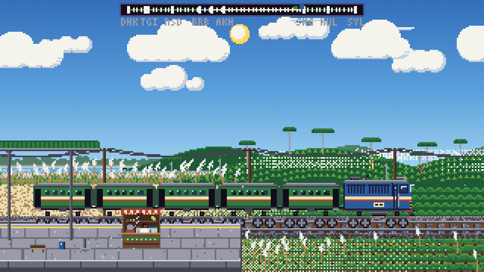
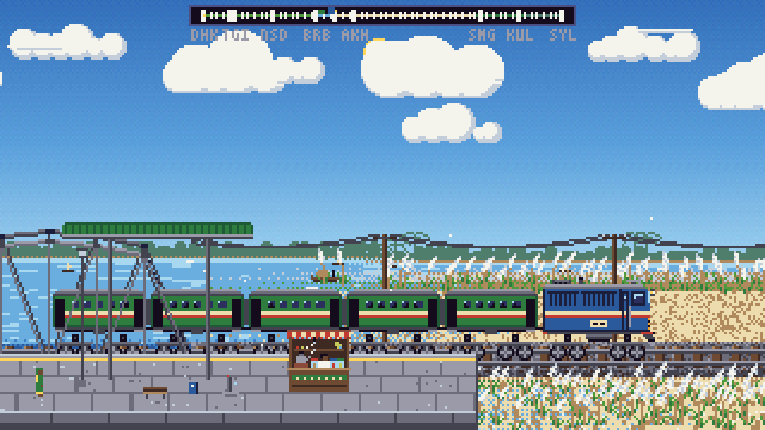
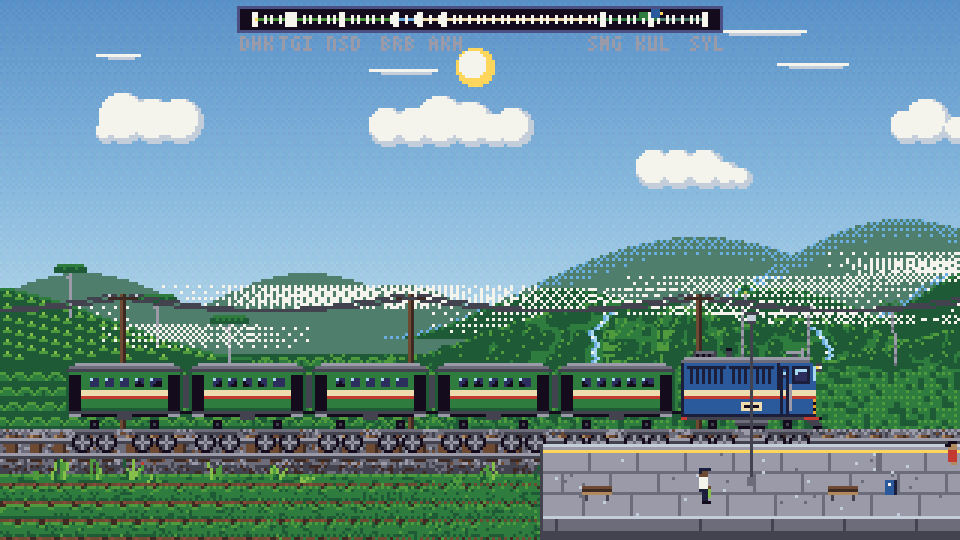

<div align="center">

# দেশি রেল · Deshi Rail

### A pixel-art train journey across Bangladesh

**▶ Play the live build: [deshi-rail.vercel.app](https://deshi-rail.vercel.app)**

Board at Kamalapur and watch the country roll past: paddy fields and village
ponds, the Jamuna on its long bridge, the white kash-phool chars, and the
south-west opening out on the run down to Khulna. Every pixel of it is drawn
from scratch on a 320×180 canvas — no sprite sheets, no image files, no
network.



**Eleven real lines · real stations · real timetables · real trains**

[](https://react.dev)
[](https://vite.dev)
[](#quick-start)
[](#testing)

</div>

---

## The journey

This is a **real-time simulation** of an intercity train ride through Bangladesh.
There is no level to beat and no score to farm: you sit in the cab (or ride
alongside) while the line unwinds in parallax — clouds drifting, kash swaying,
boats on the river, a rickshaw at the level crossing, a station crowd waiting to
board — and the light slides from noon into a dusk of lit windows and headlight
glow.

It is built as an idiomatic **React + Vite** app around a procedural pixel
engine written from scratch, carrying the **real** routes, stations and services
of Bangladesh Railway. The simulation, terrain, drawing and audio are all
generated in code — nothing is loaded from disk — and React owns the DOM.

> **Deshi Rail** — *deshi* (**দেশি**) means "of the country, homegrown", and this
> is named for the ride it recreates: the everyday trains that tie Bangladesh
> together.

## A look at the lines

<p align="center">
  
  
</p>

<p align="center"><em>Kash phool on the Meghna chars &nbsp;·&nbsp; the hills above Sylhet — both on the Dhaka–Sylhet line</em></p>

Screenshots are real frames from the engine — the project can render them itself
(see [Screenshots](#screenshots)).

## Quick start

```bash
npm install
npm run dev        # Vite dev server with HMR
npm run build      # production build into dist/
npm run preview    # serve the production build
```

Nothing is fetched at runtime: the art is generated procedurally, and the sound
is synthesised with the Web Audio API.

On load you get a **title card**. Pick a **LINE** from the dropdown in the
top-right corner, cycle through that line's services with `↑`/`↓`, then choose
**WATCH** for a cinematic ride or **DRIVE** to take the controls. (`#watch` and
`#drive` in the URL skip straight to the trip.)

## Lines

The route baked into the engine is the real **Dhaka (Kamalapur) → Khulna** line,
with every halt the intercity and mail trains actually serve — **39 stations**,
from Kamalapur (`DHK`) north-west over the Jamuna Bridge and down through
Sirajganj, Ishwardi, Kushtia, Darshana and Jessore to Khulna (`KHL`). The
**LINE** dropdown adds ten more real lines, so the country's eight divisions are
all reachable. Every line begins at **Kamalapur** and runs outward to a real
terminus:

| Line | `id` | Runs to | Stations | Length |
| --- | --- | --- | --- | --- |
| Dhaka – Khulna *(built in)* | `dhaka-khulna` | Khulna | 39 | 290 km |
| Dhaka – Sylhet | `dhaka-sylhet` | Sylhet | 58 | 319 km |
| Dhaka – Chattogram | `dhaka-chattogram` | Chattogram | 42 | 320 km |
| Dhaka – Rajshahi | `dhaka-rajshahi` | Rajshahi | 28 | 245 km |
| Dhaka – Rangpur | `dhaka-rangpur` | Rangpur | 29 | 248 km |
| Dhaka – Dinajpur | `dhaka-dinajpur` | Dinajpur | 29 | 250 km |
| Dhaka – Mymensingh – Jamalpur | `dhaka-mymensingh` | Dewanganj Bazar | 15 | 132 km |
| Dhaka – Noakhali | `dhaka-noakhali` | Noakhali | 35 | 208 km |
| Dhaka – Chandpur | `dhaka-chandpur` | Chandpur | 36 | 212 km |
| Dhaka – Cox’s Bazar | `dhaka-coxs-bazar` | Cox’s Bazar | 50 | 418 km |
| Dhaka – Barishal | `dhaka-barishal` | Barishal *(over the Padma)* | 11 | 120 km |

Each station carries its English and Bangla name, a three-letter map code, and
its real distance from Kamalapur. Stations are written once in a shared registry
and each line lists its stops in travel order as `[code, km]` pairs; the one
exception is Dhaka–Sylhet, whose 58 stops each bring their own roof, platform,
crowd and props, so that line is written out in full instead. The landscape
sections and the river bridge are defined per line (`TERRAIN`/`BRIDGE` anchors
name stations by code and are resolved by `setupTerrain`, which throws loudly if
a code is missing). A station can also brand the tea stall at its right-hand end
with `stallName`, which hangs a painted name board over the awning — Narsingdi,
on the Dhaka–Sylhet line, carries `'RIFAT TEA STALL'`.

World positions are cumulative, but every leg gets at least `CONFIG.MIN_LEG` px
of track, so even a short real gap leaves room to accelerate, run and brake.

On the Dhaka–Sylhet line, places the branch lines would add — the
Habiganj/Balla and Kulaura–Shahbazpur branches, the Sylhet–Chhatak line, and the
defunct Taltiya and Nalchata halts — are left out, so the sim always runs
straight down the main line.

### Choosing a line

`createEngine(canvas, options)` takes an optional line. `options` may carry any
of `route`, `terrain`, `bridge`, `trains` and `bnName` (the Bangla route name on
the title card); anything omitted falls back to the built-in Dhaka–Khulna line,
so `createEngine(canvas)` behaves exactly as before. The engine hands the
built-in line back as `engine.DEFAULT_LINE`, which is what the picker lists
first. Picking another line disposes the current engine and creates a new one on
it — a route change costs the same ~95 ms as the initial boot.

### Adding a station or a line

To add a **station** to an existing line, add its `[code, km]` entry to that
line's `stops` (and an `st('…', …)` registry entry if it is new). To add a whole
**line**, add a `mkLine({ id, name, bnName, stops, terrain, bridge, trains })`
entry to `LINES` in `src/lines.js`. `name` is the Latin name the picker shows;
`bnName` is the Bangla route name drawn on the title card (e.g.
`'ঢাকা থেকে খুলনা'`). A line whose stops are not shared with any other — every
stop with its own art, the way Dhaka–Sylhet is written — uses
`literalLine({ id, name, bnName, route, terrain, bridge, trains })` instead,
where `route` is the array of station objects rather than `[code, km]` pairs.
Then:

```bash
npm test          # scripts/lines-test.mjs boots and validates every line
npm run build
```

Adding a station to the built-in Dhaka–Khulna line instead means editing `ROUTE`
in `legacy/js/01-config.js` and re-running `npm run build:engine`.

## Services

`TRAINS` (per line) lists the real services, and the engine stops the train only
at the stations each one is booked to call at (`sim.calls`, built by
`buildCalls`). Each service carries its own `start`/`end` hours, so
`applyTrain()` rewrites `CONFIG.HOUR_START/END` and the day/night cycle follows
the real timetable — including overnight mails that arrive after midnight
(e.g. `end: 33.17`). `updateHour()` deliberately lets the clock pass 24 for that
case. A service with `all: true` stops everywhere, which is what a mail does.

Everywhere the old engine assumed "the next stop is the next station"
(`sim.station + 1`), the code now asks `nextCallIdx()` (with `prevCallIdx()` for
recovering a missed stop), so express services run past the halts they do not
serve. Junctions and big towns carry a `major` flag: their codes are drawn on
the route map, and the arrival banner calls them out even when the train runs
through without stopping.

On the built-in Dhaka–Khulna line the three real services are:

| Train | Service | Stops |
| --- | --- | --- |
| 725/726 | Sundarban Express | 6 (Airport, Bangabandhu Bridge West, Ullapara, Ishwardi, Kushtia, Jessore) |
| 763/764 | Chitra Express | 7 (the same, plus Darshana) |
| 15/16 | Khulna Mail | 12 |

On every line except Dhaka–Sylhet, services call only at **main stations**: none
of the other services books the little Dhaka suburban halts (Tejgaon, Banani,
Cantonment), so the trains run straight past them, and each mail lists its
principal stops explicitly instead of using `all: true`. The Dhaka–Sylhet line's
Surma Mail is the one exception — it stops everywhere, as a mail should. Crowds
gather, passengers board and alight, and the guard waves the flag at every booked
stop on every line.

> The embedded `stop` codes are matched by code and unknown codes are ignored, so
> a typo means a silently skipped stop. `scripts/lines-test.mjs` guards against
> this by asserting every listed stop is really booked.

## Controls

On the title card, `↑`/`↓` cycle through the line's real trains (or click the
`[` / `]` either side of the name). The **LINE** dropdown switches routes and
restarts the app on the new line's title card. Choose WATCH or DRIVE with the
on-screen buttons, or `←`/`→` and `Enter`/`Space`. `C` jumps straight into DRIVE.

The toolbar holds every control; each also has a keyboard shortcut:

| Button | Key | Action |
| --- | --- | --- |
| AUTO / DRIVE | `C` | Toggle driver mode (WATCH ↔ DRIVE) |
| START | `E` | Start / stop the engine |
| FWD / REV | `R` | Reverse / forward |
| POWER | `↑` | Power up / release brake |
| BRAKE | `↓` | Power down / brake (`B` = emergency) |
| OPEN | `O` | Open the doors |
| HORN | `H` | Horn (hold) |
| LIGHT | `L` | Headlight |
| PAUSE | `P` / `Space` | Pause |
| 1x / 2x / 4x | `1` `2` `4` | Simulation speed (WATCH mode) |
| NEXT | `N` | Skip to the next booked stop |
| TIME | `T` | Time of day: AUTO / DAY / DUSK / NIGHT |
| RAIN | `W` | Weather: AUTO / rain |
| TAP | `M` | Mute / unmute sound |
| — | `F` | Hold to fast-forward |

Debug overlay: `D`.

## Features

- **A fixed 320×180 pixel canvas**, upscaled with nearest-neighbour scaling on a
  Bayer-dithered 32-colour palette. A full day/night cycle cross-fades the whole
  palette, and windows, lamps and the headlight add their own glow.
- **Eleven real lines** across all eight divisions, chosen from the LINE dropdown
  on the title card — Dhaka–Khulna plus the ten in `src/lines.js` (Sylhet,
  Chattogram, Rajshahi, Rangpur, Dinajpur, Mymensingh/Jamalpur, Noakhali,
  Chandpur, Cox’s Bazar, Barishal), each with its own real stations, terrain,
  river bridges and services.
- **Real stations** with English and Bangla names, name boards, roofs, crowds,
  boarding and a guard's departure flag — and a station that can name the tea
  stall on its platform.
- **Real services**, each with its own booked stops and its own clock, chosen on
  the title card. Express trains run past the halts they do not serve.
- **Parallax scenery** in five layers (clouds, far, mid, track, foreground)
  across five procedurally generated landscape sections: village paddies and
  ponds, rivers with steel truss bridges, kash-phool chars, tea gardens and
  hills — all with swaying plants, animals, boats, rickshaws and people.
- **A full driving model** in DRIVE mode: 8 power notches, 4 brake steps plus
  emergency, inertia, drag, and a timetabled schedule with on-time scoring.
  There are **no speed limits** — the driver may run at any speed they dare.
- **Living details:** exhaust smoke, rain and lightning, birds, fishing with cast
  nets, shimmering water, bridge reflections, horn waves, and a chugging audio
  bed synthesised with the Web Audio API.
- **Responsive layout:** the toolbar sits under the picture in portrait and
  beside it on wide screens, with safe-area padding for notched devices. Low-end
  devices automatically drop to lighter particle budgets.

## How it works

The engine lives as 13 ordered classic `<script>` files (`legacy/js/01-config.js`
… `legacy/js/13-main.js`) that share a single global scope and run with no build
step at all. A bundler wants ES modules, so `scripts/build-engine.mjs`
concatenates those files, **in the same order**, into the body of a
`createEngine()` factory. Concatenation preserves the shared scope exactly, so
the simulation, terrain, train, weather and audio code carries over unchanged —
only the DOM-facing parts differ:

- **Module 12** no longer reads `#screen` or mutates the toolbar buttons itself.
  It exposes the live state objects (`sim`, `drive`, `ui`, `audio`, …), the
  `actions` table and `subscribe()`; calling `syncButtons()` now just notifies
  subscribers instead of touching the DOM.
- **Module 13** no longer owns the responsive `fit()` layout or the `#bar`
  element. The frame loop is the same, plus a `disposed` guard so React can tear
  the engine down cleanly on unmount (important with StrictMode's double-mount).
- Window and canvas listeners are named functions, so `createEngine()` can return
  a `dispose()`.

`src/App.jsx` calls `createEngine(canvasRef.current, options)` in an effect, then:

- `useEngineStore(engine)` re-renders the app whenever the engine bumps its
  revision counter (via `useSyncExternalStore`);
- `Toolbar` reads the live state directly and renders the AUTO/DRIVE button sets;
- `RoutePicker` lists the built-in line plus everything in `src/lines.js` and, on
  a change, re-creates the engine on the chosen line;
- `useFitLayout` owns the responsive sizing — toolbar under the
  picture in portrait, beside it on wide screens, or floating over the bottom of
  the picture when there is no room.

Keyboard shortcuts are handled by the engine (as named listeners), so they
work regardless of focus. After editing anything in `legacy/js`, regenerate the
engine:

```bash
npm run build:engine
```

## Project structure

```
index.html              Vite entry (mounts <div id="root">)
vite.config.js          Vite + @vitejs/plugin-react config
src/main.jsx            React root; StrictMode + global CSS
src/App.jsx             owns the canvas + toolbar, boots the engine, picks the line
src/lines.js            the selectable lines (stations, terrain, bridges, trains)
src/styles.css          page, canvas, toolbar and route-picker styling
src/components/
  Toolbar.jsx           the controls, driven by live engine state
  RoutePicker.jsx       the LINE dropdown on the title card
  Icon.jsx              the 16×16 pixel SVG icons
src/hooks/
  useEngineStore.js     useSyncExternalStore bridge to engine state
  useFitLayout.js       the responsive canvas/toolbar layout
src/engine/
  engine.js             the engine (see above) — imported by App
scripts/
  build-engine.mjs      regenerates src/engine/engine.js from legacy/js
  screenshot.mjs        renders real frames of the game to PNG (no browser)
  smoke-test.mjs        headless engine boot/step/render/dispose test
  route-test.mjs        headless route/service/AUTO/DRIVE behaviour test
  lines-test.mjs        boots and validates every selectable line
  react-ssr-test.mjs    renders the React components (no browser)
  dev-check.mjs         boots the dev server and loads the entry modules
  preview-check.mjs     serves dist/ and checks the bundle
docs/                   the screenshots used above
legacy/                 a standalone no-build copy of the engine's 13 scripts
```

## Testing

```bash
npm test                          # engine smoke test + route test + lines + React render
npm run check                     # the above, plus a dev-server load check
npm run build && node scripts/preview-check.mjs   # checks the production bundle
```

- `scripts/smoke-test.mjs` boots the engine against a stubbed canvas and steps it
  a few frames, so a broken simulation, render pass or `dispose()` is caught
  without a browser.
- `scripts/route-test.mjs` checks the built-in line and its services: 39 stations
  with unique codes and rising distances, every train's stop list resolving to
  real stations, `nextCallIdx` always moving forward; then it skips ahead and
  runs a whole AUTO journey on a synthetic clock, asserting the train stands only
  at its booked stops — and finishes with a short DRIVE shift (crank, doors,
  power, pull away).
- `scripts/lines-test.mjs` boots the engine once for the built-in line and once
  for every line in `src/lines.js`, asserting each is internally consistent:
  unique station codes, rising `km`, every leg ≥ `MIN_LEG`, full English/Bangla
  names and Bangla masks, terrain starting with an unbounded section, a
  resolvable bridge anchor, every service's stops really booked, and that
  `DEFAULT_LINE` is exposed.
- `scripts/react-ssr-test.mjs` loads the components through Vite and renders the
  toolbar in both AUTO and DRIVE modes, the route picker, and `App` itself.
- `scripts/dev-check.mjs` starts the dev server and fetches the entry modules.
- `scripts/preview-check.mjs` serves the production build and checks the bundle.

## Screenshots

The pictures above are produced by the game itself, not by hand. A browser
rasterises the canvas; `scripts/screenshot.mjs` stands in for it with a small
software implementation of the slice of the Canvas 2D API the engine uses
(`fillRect`, `drawImage`, patterns, gradients, the ordered-dither composites,
clipping and the mirror transforms used when sprites are baked), boots the real
engine against it, drives it to a chosen spot on a line, and writes the frame out
as a nearest-neighbour upscaled PNG. Node's `zlib` does the encoding, so there is
nothing to install.

```bash
npm run screenshots                                  # all three, into docs/
npm run screenshot                                    # just the hero
node scripts/screenshot.mjs --list                    # named spots on the lines
node scripts/screenshot.mjs --at "BRB+240" --time dusk   # anywhere, on any clock
```

It also takes `--line ID` (each scene names the line it needs, and `--at` picks a
line that has that station), `--train N`, `--scale N`, `--frames N`, `--out FILE`
and `--title` (the title card drawn over the scene), and `--ascii` prints the
frame as a palette map (`--crop x0,y0,x1,y1`, `--step N`) so it can be checked on
a machine with no image viewer.

## legacy/

A no-build, dependency-free copy of the engine — the 13 classic scripts,
`css/styles.css`, `index.html` and `serve.mjs` — lives under `legacy/` and runs
on its own with no bundler. `src/engine/engine.js` is generated from `legacy/js`
by `npm run build:engine`; never edit the generated file by hand.

## Credits & disclaimer

Bangla text is set in **নজরুল পিক্সেল** (Nazrul Pixel), a Bengali pixel font used
here for a personal project under its own EULA — see
`public/fonts/NAZRUL-PIXEL-LICENSE.txt` for the terms and attribution.

Not affiliated with, endorsed by, or connected to **Bangladesh Railway**; the
route, station, service and timetable data is public information, reproduced here
for the pleasure of the ride.

<div align="center"><sub>শুভ যাত্রা — have a good journey.</sub></div>
